# NEXUS OSB — Industrial Zone Operating System

**English** · [Türkçe](README.tr.md)

> An operating system for a **whole industrial zone**, not a single factory. It makes its own decisions,
> lets the factories negotiate with each other, and runs the future ahead of time.

If a factory OS runs one factory, NEXUS OSB runs the city those factories live in. 30 sites, a shared energy grid,
a green hydrogen valley, a 48-truck fleet, a shared technician pool, central wastewater treatment, waste exchange,
a carbon ledger, a capacity marketplace and a crisis center all work together, live. A local AI runs the zone on
**autopilot**, site agents **bargain** with each other, the system copies itself to **forecast the future**, and it
proves the outcome of different policies in **parallel universes**.

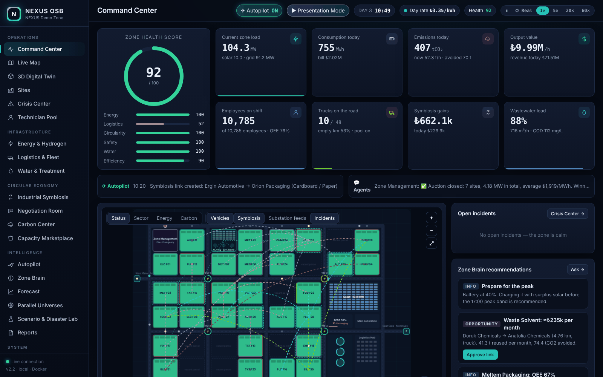

> **Note:** NEXUS OSB is a simulation. The 30 sites and all figures are simulated assumptions. As real data is
> connected (electricity price, weather, live site data, historical records), measurements replace the model.
> "OSB" is short for *Organize Sanayi Bölgesi*, Turkish for "organized industrial zone".

---

## Quick start (Windows · PowerShell)

With Docker Desktop running, in the project folder:

```powershell
powershell -ExecutionPolicy Bypass -File .\start.ps1
```

or by hand:

```powershell
docker compose up -d --build
Start-Process http://localhost:8080
```

On macOS / Linux: `docker compose up -d --build`, then open http://localhost:8080.

Stop with `docker compose down`. To also delete the stored logs: `docker compose down -v`.

**First thing to try:** press **▶ Presentation Mode** in the top bar. The system explains itself in 15 steps:
it turns on the autopilot, runs parallel universes, plays out an earthquake, and puts everything back at the end.
Press **🔊 Voice** to have it narrated aloud.

### Ollama for the Zone Brain (optional, free, local)

```powershell
ollama pull llama3.2
```

NEXUS finds the Ollama on your computer automatically via `host.docker.internal:11434`. For a specific model,
set `OLLAMA_MODEL: "qwen2.5"` in `docker-compose.yml`. Without Ollama, the built-in **local analyst** answers with
live data and carries out commands. No cloud service is used.

---

## Screens (22)

| Section | Screen | Highlights |
|---|---|---|
| Operations | **Command Center** | Health score, 8 live indicators, map, autopilot and agent tickers, one-click recommendations |
| | **Live Map** | 4 layers plus trucks, technicians, symbiosis links, H₂ line, substations, incidents, earthquake waves, gas cloud, wind compass |
| | **3D Digital Twin** | three.js · building height = installed power, stack smoke = current emissions (drifts with the wind), night lights, symbiosis tubes, drone tour, camera shake during earthquakes |
| | **Sites** | Sortable table plus a site drawer |
| | **Crisis Center** | Response steps, incident log, technician and fire brigade tracking |
| | **Technician Pool** | 12 specialist technicians shared between sites; the right skill + nearest + most senior goes to each fault, cutting downtime by ≈45% |
| Infrastructure | **Energy & Hydrogen** | Flow diagram, solar, battery strategy, substations, **Hydrogen Valley** (12 MWp dedicated solar → electrolyser → up to 30% green H₂ for foundry and metal furnaces) |
| | **Logistics & Fleet** | Shared fleet pool, gates, orders |
| | **Water & Treatment** | COD, capacity, water reuse |
| Circular economy | **Industrial Symbiosis** | Opportunity engine, links |
| | **Negotiation Room** | Site agents with personalities negotiate live: **flexibility auctions**, **waste price bargaining**, **truck sharing** · Zone Credit ledger |
| | **Carbon Center** | Scope 1/2/logistics, avoided emissions (solar + biogas + H₂ + symbiosis), EU CBAM cost |
| | **Capacity Marketplace** | Matches for idle capacity |
| Intelligence | **Autopilot** | 10 rules, a scan every 10 min, a decision log with reasons, human approval for big investments |
| | **Zone Brain** | Ollama chat + **command execution** + **🎙 voice commands** + spoken replies |
| | **Forecast** | The zone is copied 6 times and run 24 hours ahead (Monte Carlo) · hourly risk calendar, p10–p90 band |
| | **Parallel Universes** | The same zone fast-forwarded for days under two policies · net ₺ impact, annualised gain, 14 indicators |
| | **Scenario & Disaster Lab** | 8 scenarios: grid outage, price hike, gas curtailment, export rush, heat wave, port disruption, **earthquake**, **chemical leak** |
| | **Reports** | End-of-day reports, CSV, PDF |
| System | **Real Data** | EPİAŞ electricity price, weather, calibration from historical data, Fabrika OS bridge, real time |
| | **Zone Designer** | Draw and build your own zone layout |
| | **Integration** | REST/MQTT, all API endpoints |

### Screenshots

| | |
|---|---|
| 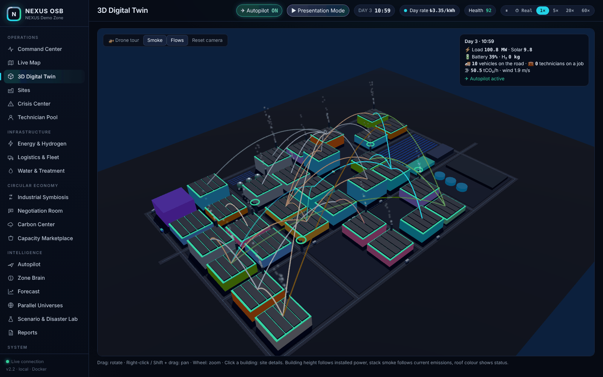 **3D Digital Twin** | 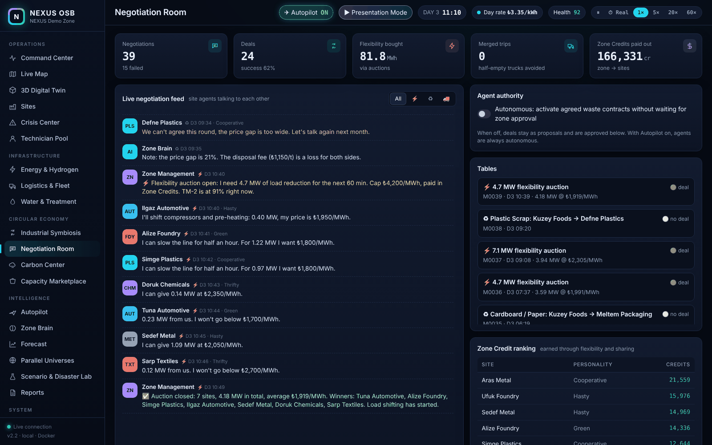 **Negotiation Room** — agents bargain live |
| 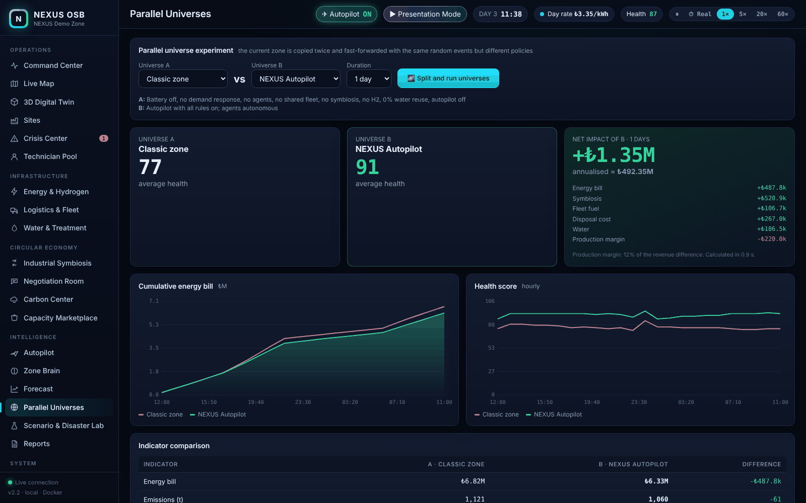 **Parallel Universes** — classic zone vs. NEXUS autopilot | 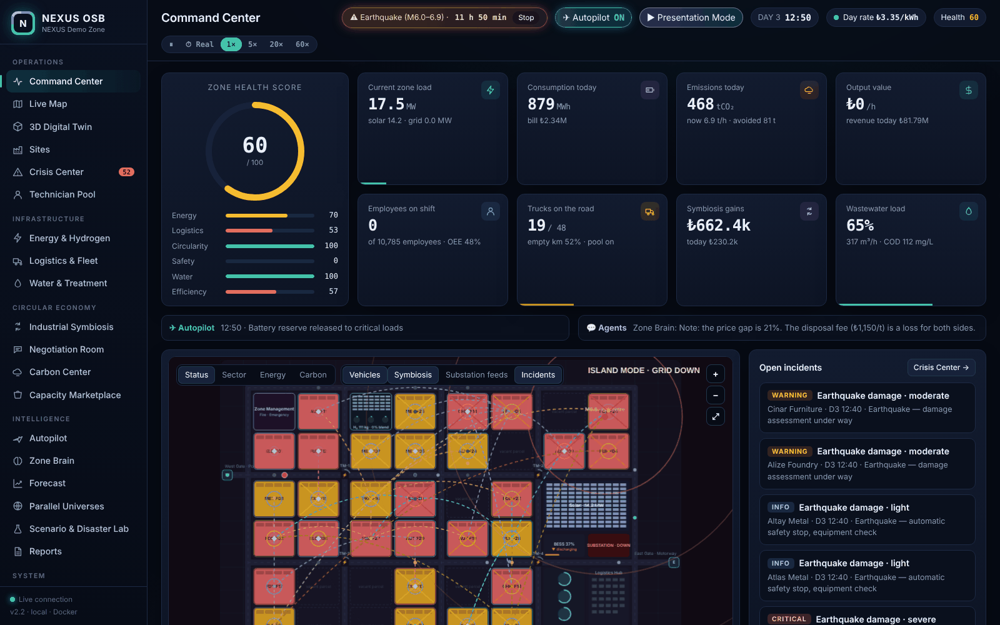 **Earthquake** — island mode, grid down |
| 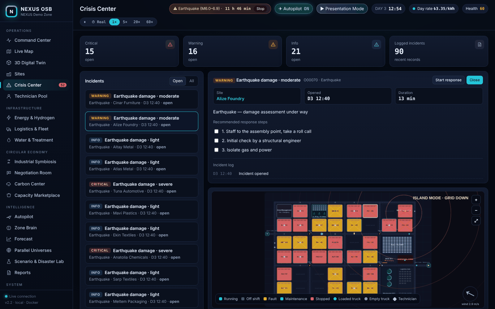 **Crisis Center** | 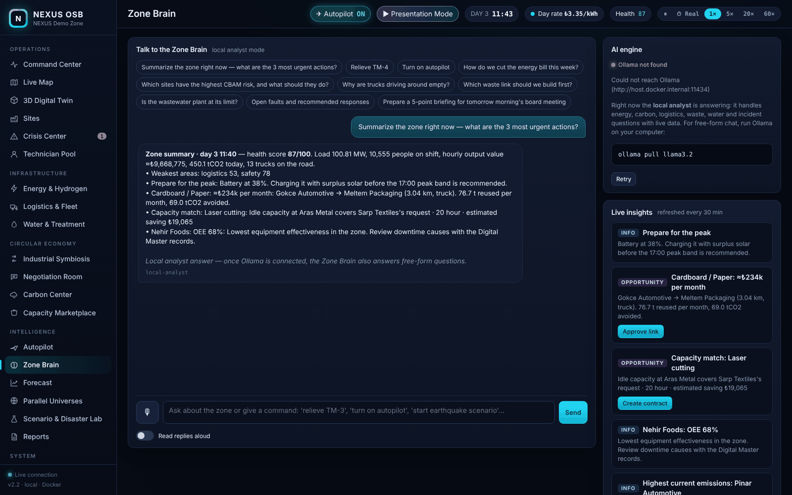 **Zone Brain** |
| 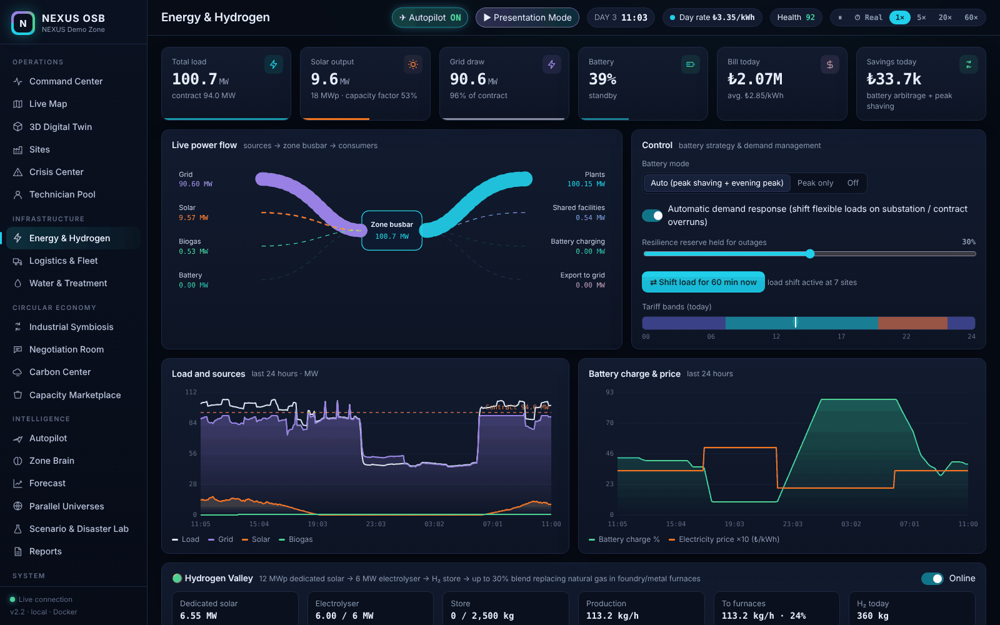 **Energy & Hydrogen** | 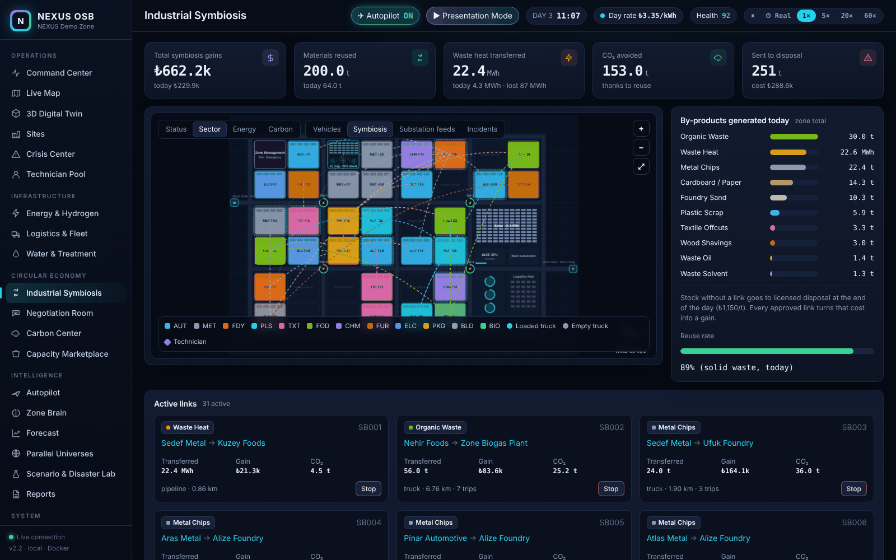 **Industrial Symbiosis** |
| 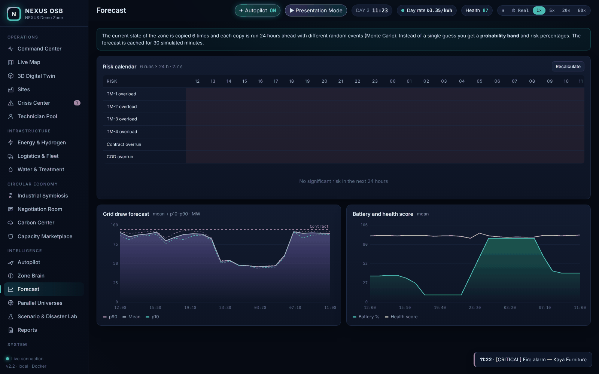 **Forecast** — 24-hour Monte Carlo | 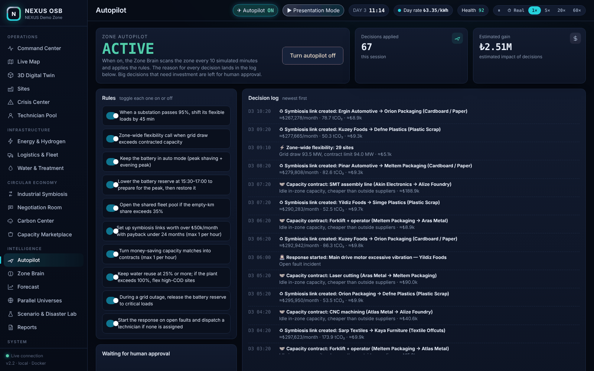 **Autopilot** |
| 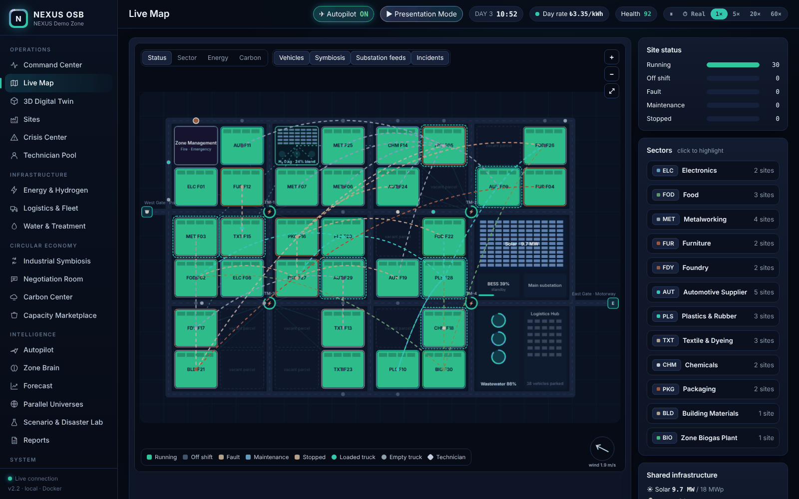 **Live Map** | 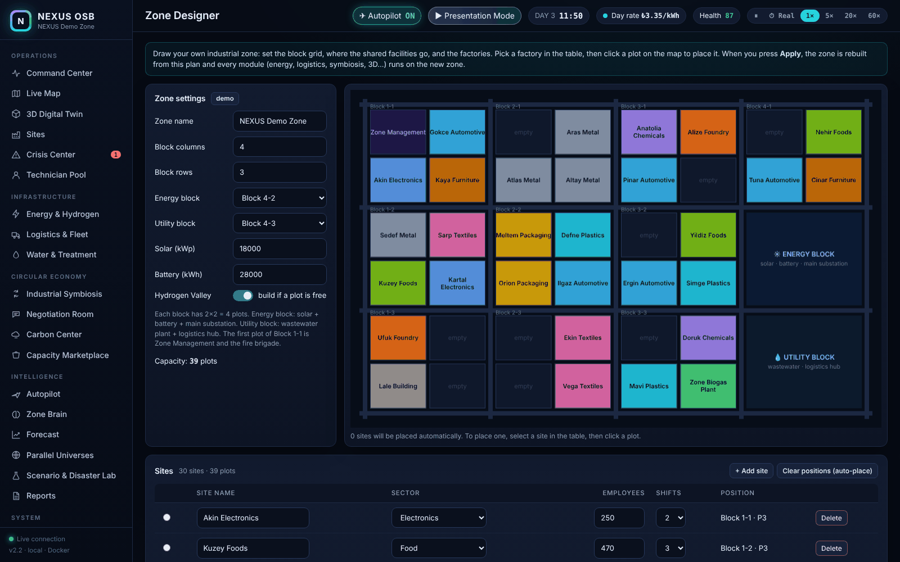 **Zone Designer** |

### Voice and text commands (Zone Brain)

`relieve TM-3` · `turn on autopilot` · `open the fleet pool` · `battery auto` · `set water reuse to 30%` ·
`turn off hydrogen` · `start earthquake scenario` · `stop scenario`

The microphone works in Chrome and Edge; speech recognition is done by the browser's own service.
Turkish commands are understood too.

---

## What's inside

- **Autopilot** — rules for the battery, peak preparation, substation and contract overruns, the fleet pool, symbiosis, the marketplace, water, outages and incidents. Every decision is logged with its reason and estimated gain.
- **Factories that talk** — each site has a personality (thrifty, cooperative, green, hasty). Offers, counter-offers and concessions unfold over minutes. Outcomes are really applied: load is shifted, symbiosis links are built, truck trips are merged.
- **Technician Pool** — fault types are matched to skills (mechanical, hydraulic, electrical, automation, combustion, cooling). Technicians move on the map and in 3D.
- **Hydrogen Valley** — green H₂ produced independently of the grid replaces natural gas in foundry and metal furnaces, cutting Scope 1.
- **Disaster mode** — earthquake: damage by distance from the epicentre, island mode, gas valves, loss of treatment, aftershocks, fires. Chemical leak: a cloud that grows and turns with the wind, evacuation.
- **Forecast and Parallel Universes** — the world model is copied and run on a separate thread; the live zone is not affected.
- **Presentation Mode** — a 15-step automatic walkthrough for investor and CTO meetings.
- **3D Digital Twin** — three.js is bundled with the project, so it works offline too.

Net impact covers the energy bill, symbiosis, fleet fuel, disposal cost (₺1,150/t), water (₺45/m³) and production
margin (12% of the revenue difference). All figures are simulation assumptions.

---

## Connecting to reality (Real Data and Zone Designer screens)

| Feature | How it works |
|---|---|
| **Real electricity price** | The EPİAŞ (Turkish power exchange) day-ahead market clearing price (MCP) is fetched hourly; unit price paid = MCP/1000 + a fixed component (distribution, YEKDEM, taxes; default ₺1.85/kWh, editable on screen). The battery and demand shifting treat the 5 most expensive hours of the day as "peak". Without an EPİAŞ account, upload an MCP Excel/CSV file downloaded from the Transparency Platform. |
| **Real weather** | Cloud, temperature and wind from Open-Meteo (free, no key). Cloud → solar and H₂ output; temperature → cooling, heating gas, water; wind → smoke and chemical cloud direction. 16 industrial cities ready, or enter any coordinates. |
| **Zone Designer** | Block grid (2–8 × 2–6), energy and utility blocks, solar/battery size, sites (name, sector, employees, shifts, plot). Place by clicking on the map, download/upload JSON, rebuild the zone in one click. The plan is saved in `/data/bolge.json`. |
| **Fabrika OS bridge** | Any URL that returns JSON (Fabrika OS, SCADA, PLC gateway) is read at regular intervals. The wizard lists all fields and suggests power/status/OEE/output automatically; W→kW multiplier and RUN/STOP/FAULT → status conversion are built in. A connected site shows as "live" on the map. |
| **Calibration from history** | Upload hourly / 15-min / daily / monthly records for a site (CSV or .xlsx; both `1,234.5` and Turkish `1.234,5` number formats work); installed power, the 24-hour load profile, output rate, and gas and water factors are fitted to that site. Preview first, then apply. A template file can be downloaded on screen. |
| **Real time** | ⏱ Real in the top bar: the simulation clock is synced to the real clock and runs 1 s = 1 s. |

To connect an EPİAŞ account permanently (the password is only stored in the `.env` file on your computer):

```powershell
Set-Content .env "EPIAS_KULLANICI=you@example.com`nEPIAS_SIFRE=yourpassword" -Encoding ASCII
docker compose up -d
```

To find the Fabrika OS port: `docker ps --format "table {{.Names}}`t{{.Ports}}"` — in the bridge URL use
`host.docker.internal` instead of `localhost`.

All settings (`fiyat`, `hava`, `kopruler`, `kalibrasyon`) are saved in `/data/ayarlar.json` and survive container restarts.

---

## Pushing live data

```powershell
Invoke-RestMethod -Method Post -Uri http://localhost:8080/api/veri/F01 `
  -ContentType "application/json" `
  -Body '{"power_kw": 1850, "durum": "calisiyor", "oee": 0.83, "uretim_dk": 9.5, "gecerlilik_dk": 15}'
```

`durum` (status) values: `calisiyor` (running), `bosta` (idle), `ariza` (fault), `bakim` (maintenance), `durdu` (stopped).

MQTT (Mosquitto in the compose file, port 1883): subscribe `nexus/fabrika/{id}/telemetri`, publish `nexus/bolge/kpi`.
Swagger: http://localhost:8080/docs

> The API paths and JSON field names keep their original Turkish identifiers (`/api/enerji`, `durum`, `uretim_dk`…)
> so existing integrations keep working. Every screen, message and AI reply is in English.

---

## Project structure

```
nexus-osb/
├─ docker-compose.yml · start.ps1 · baslat.ps1 (Turkish launcher) · mosquitto/
├─ docs/screenshots/
└─ backend/
   ├─ Dockerfile · requirements.txt · tests/test_sim.py (16 tests)
   └─ app/
      ├─ main.py        FastAPI · WebSocket · MQTT · forecast/universe jobs
      ├─ ai.py          Zone Brain: Ollama + local analyst + command executor
      ├─ store.py       SQLite event and day log
      ├─ realdata.py    EPİAŞ price + Open-Meteo + persistent settings
      ├─ bridge.py      Fabrika OS / SCADA JSON bridge
      ├─ calibrate.py   Site calibration from historical data
      ├─ tabular.py     CSV/Excel reader (English and Turkish formats)
      ├─ sim/           world · factory · energy · hydrogen · logistics · masters · symbiosis · market
      │                 water · incidents · disaster · autopilot · agents · foresight · geo · data
      └─ static/        app.js · ui.js · map.js · tour.js · pages/ (22 screens) · vendor/three.module.min.js
```

Local development:

```powershell
cd backend
pip install -r requirements.txt
uvicorn app.main:app --port 8080 --reload
python -m pytest -q
```

Environment variables: `EPIAS_KULLANICI`, `EPIAS_SIFRE`, `OLLAMA_URL`, `OLLAMA_MODEL`, `MQTT_HOST`, `MQTT_PORT`,
`NEXUS_SEED`, `NEXUS_PREWARM_MIN`, `DATA_DIR`.

---

## Tech stack

Python · FastAPI · WebSocket · SQLite · paho-mqtt · Mosquitto · vanilla JavaScript (ES modules) · canvas · SVG charts ·
three.js · Web Speech API · Ollama · Docker.

## License

[MIT](LICENSE)
