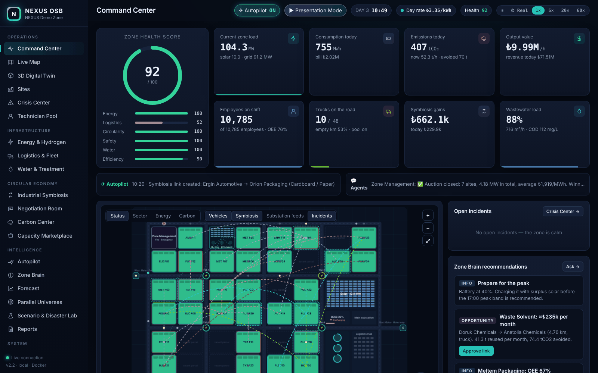

# NEXUS OSB — Sanayi Bölgesi İşletim Sistemi

[English](README.md) · **Türkçe**

> Tek bir fabrikayı değil, **bütün bir organize sanayi bölgesini** yöneten, kendi kararını veren ve
> geleceğini önceden koşturan işletim sistemi.

Fabrika OS bir fabrikanın işletim sistemiyse, NEXUS OSB o fabrikaların yaşadığı şehrin işletim sistemidir.
30 tesis, ortak enerji şebekesi, hidrojen vadisi, 48 araçlık filo, usta havuzu, merkezi arıtma, atık takası,
karbon defteri, kapasite pazaryeri ve kriz merkezi canlı olarak birlikte çalışır. Yerel yapay zekâ bölgeyi
**otopilotta** yönetir, tesis ajanları birbirleriyle **pazarlık eder**, sistem kendi kopyalarını ileri sararak
**geleceği tahmin eder** ve farklı kararların sonucunu **paralel evrenlerde** kanıtlar.

> **v2.2 notu:** Arayüz, sistem mesajları, ajan konuşmaları, Bölge Beyni yanıtları ve sunum turu artık
> **İngilizce**. Bölge Beyni Türkçe komutları da anlamaya devam eder (`TM-3'ü rahatlat`, `otopilotu aç`…).
> API yolları ve JSON alan adları (`/api/enerji`, `durum`, `uretim_dk`…) değişmedi; mevcut bağlantılar çalışır.



---

## Hızlı başlangıç (Windows · PowerShell)

Docker Desktop açıkken, proje klasöründe:

```powershell
powershell -ExecutionPolicy Bypass -File .\baslat.ps1
```

(İngilizce mesajlı başlatıcı: `.\start.ps1`)

veya elle:

```powershell
docker compose up -d --build
Start-Process http://localhost:8080
```

Durdurmak için `docker compose down` · Kayıtları da silmek için `docker compose down -v`.

**İlk deneme:** üst çubuktaki **▶ Presentation Mode** (Sunum Modu) düğmesine bas. Sistem 15 adımda kendini anlatır:
otopilotu açar, paralel evrenleri koşturur, bir deprem canlandırır ve sonunda her şeyi eski hâline getirir.
**🔊 Voice** ile sesli anlatım açılır.

### Bölge Beyni için Ollama (isteğe bağlı, ücretsiz, yerel)

```powershell
ollama pull llama3.2
```

NEXUS, bilgisayarındaki Ollama'yı `host.docker.internal:11434` üzerinden otomatik bulur. Ollama yoksa yerleşik
**yerel analist** gerçek verilerle cevap verir ve komutları uygular. Hiçbir bulut servisi kullanılmaz.

---

## Ekranlar (22)

| Bölüm | Ekran (arayüzdeki adı) | Öne çıkan |
|---|---|---|
| Operasyon | **Komuta Merkezi** (Command Center) | Sağlık skoru, 8 canlı gösterge, harita, otopilot ve ajan şeridi |
| | **Canlı Harita** (Live Map) | 4 katman + araç, usta, simbiyoz, H₂ hattı, trafo, olay, deprem dalgası, gaz bulutu |
| | **3D Dijital İkiz** (3D Digital Twin) | Bina yüksekliği = kurulu güç, baca dumanı = anlık emisyon, gece ışıkları, drone turu |
| | **Tesisler** (Sites) | Sıralanabilir tablo + tesis çekmecesi |
| | **Kriz Merkezi** (Crisis Center) | Müdahale adımları, olay kaydı, usta/itfaiye takibi |
| | **Usta Havuzu** (Technician Pool) | 12 uzman usta tesisler arasında paylaşılır, duruş ≈%45 kısalır |
| Altyapı | **Enerji & Hidrojen** (Energy & Hydrogen) | Akış şeması, GES, batarya, trafolar, Hidrojen Vadisi |
| | **Lojistik & Filo** (Logistics & Fleet) | Ortak filo havuzu, kapılar, siparişler |
| | **Su & Arıtma** (Water & Treatment) | KOİ, kapasite, geri kazanım |
| Döngüsel ekonomi | **Endüstriyel Simbiyoz** (Industrial Symbiosis) | Fırsat motoru, bağlantılar |
| | **Müzakere Odası** (Negotiation Room) | Esneklik ihalesi, atık pazarlığı, kamyon paylaşımı · OSB Kredisi (Zone Credits) |
| | **Karbon Merkezi** (Carbon Center) | Kapsam 1/2/lojistik, kaçınılan emisyon, AB SKDM (CBAM) yükü |
| | **Kapasite Pazaryeri** (Capacity Marketplace) | Atıl kapasite eşleşmeleri |
| Zekâ | **Otopilot** (Autopilot) | 10 kural, gerekçeli karar günlüğü, büyük yatırımlar için insan onayı |
| | **Bölge Beyni** (Zone Brain) | Ollama sohbeti + komut yürütme + sesli komuta |
| | **Gelecek Tahmini** (Forecast) | 24 saatlik Monte Carlo, saatlik risk takvimi |
| | **Paralel Evrenler** (Parallel Universes) | Aynı bölge iki politikayla ileri sarılır · net ₺ etkisi |
| | **Senaryo & Afet Lab** (Scenario & Disaster Lab) | 8 senaryo, deprem ve kimyasal sızıntı dahil |
| | **Raporlar** (Reports) | Gün sonu raporları, CSV, PDF |
| Sistem | **Gerçek Veri** (Real Data) | EPİAŞ PTF, hava durumu, kalibrasyon, Fabrika OS köprüsü |
| | **Bölge Tasarımcısı** (Zone Designer) | Kendi OSB planını çiz ve kur |
| | **Entegrasyon** (Integration) | REST/MQTT, tüm API uçları |

Ekran görüntüleri: [docs/screenshots](docs/screenshots) · ayrıntılı anlatım ve görseller için [İngilizce README](README.md).

---

## Gerçek veri bağlama

EPİAŞ hesabını kalıcı bağlamak için (şifre yalnızca bilgisayarındaki `.env` dosyasında durur):

```powershell
Set-Content .env "EPIAS_KULLANICI=kullanici@ornek.com`nEPIAS_SIFRE=sifren" -Encoding ASCII
docker compose up -d
```

Bir tesise canlı veri göndermek:

```powershell
Invoke-RestMethod -Method Post -Uri http://localhost:8080/api/veri/F01 `
  -ContentType "application/json" `
  -Body '{"power_kw": 1850, "durum": "calisiyor", "oee": 0.83, "uretim_dk": 9.5, "gecerlilik_dk": 15}'
```

MQTT: abone `nexus/fabrika/{id}/telemetri`, yayın `nexus/bolge/kpi`. Swagger: http://localhost:8080/docs

Rakamların tamamı simülasyon varsayımıdır; gerçek veri bağlandıkça modelin yerini ölçüm alır.

## Lisans

[MIT](LICENSE)
